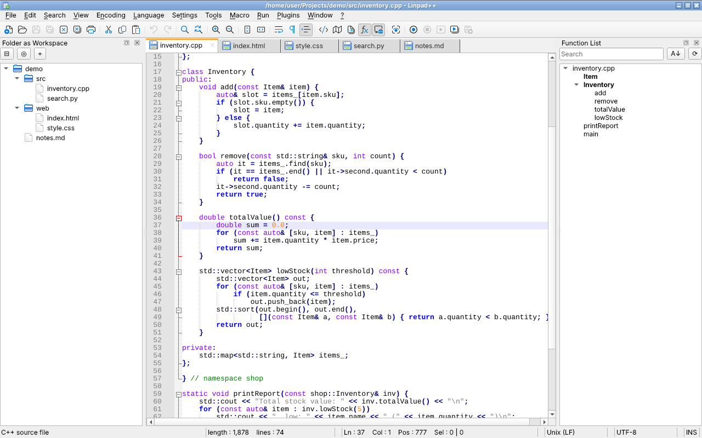
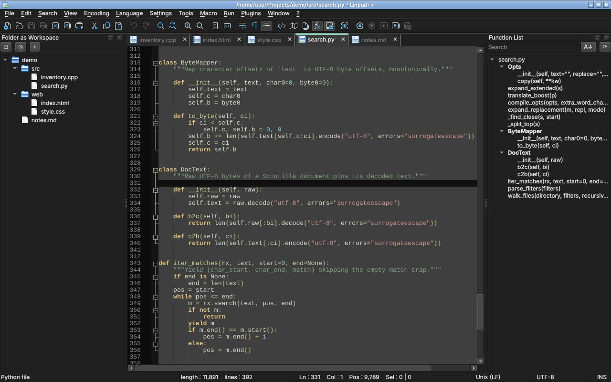
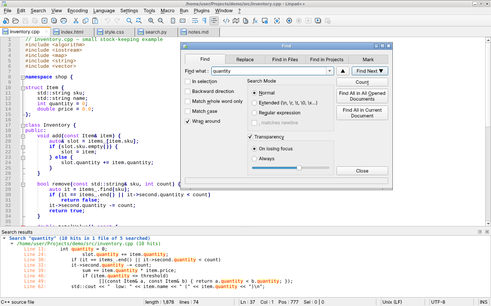
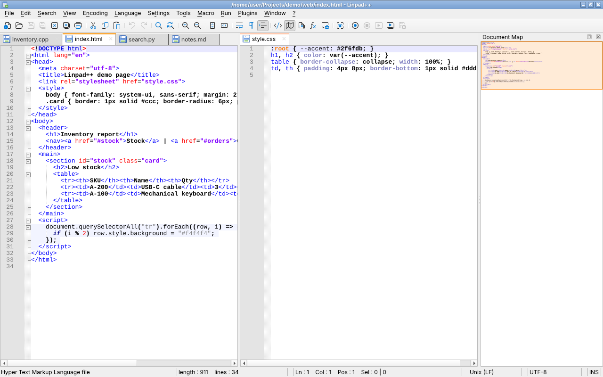
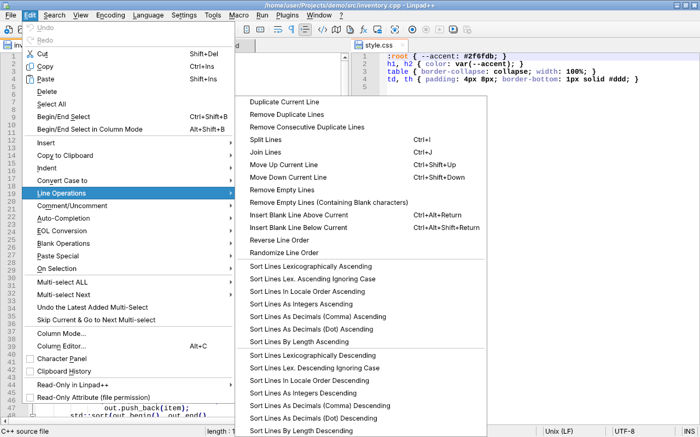
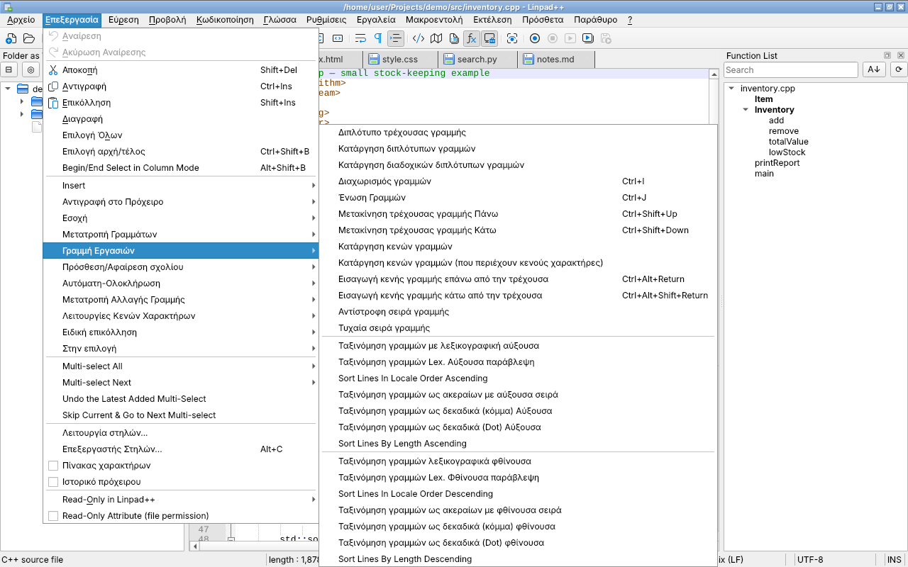
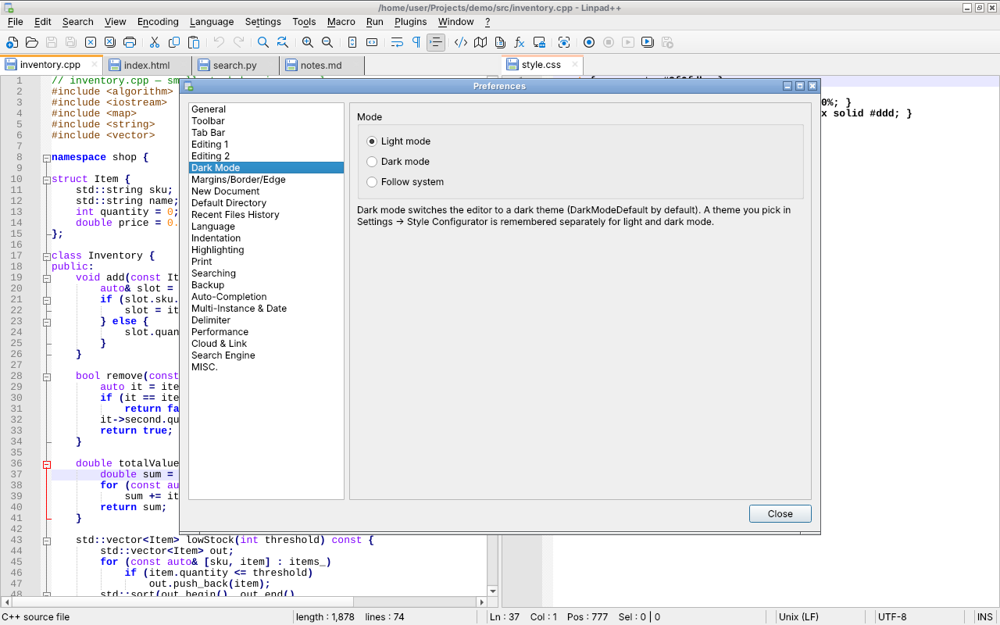
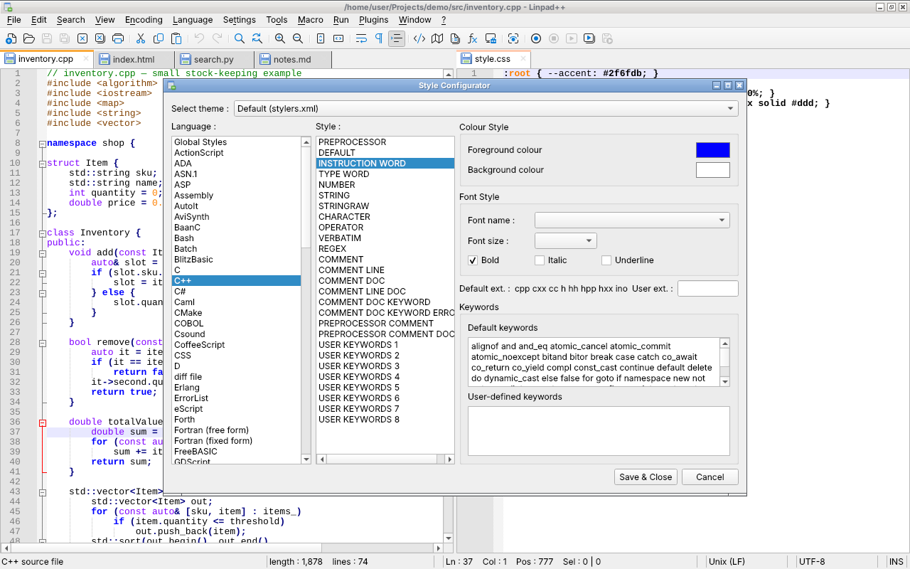

# Linpad++ 1.0.2 — Notepad++ for Linux

Linpad++ is a native Linux source-code editor that works like **Notepad++ 8.9.6.2**: the same menus, command IDs and default shortcuts, the same two-view tabbed editor, the same panels and dialogs, and the same language, theme and localization files. It is written in Python with PyQt6 and the Scintilla editing engine (via QScintilla), and ships as a single AppImage for Ubuntu 24.04 and other recent x86_64 distributions.

**Download:** the latest AppImage is on the [Releases](https://github.com/demosthenesk/Linpad-plus-plus/releases/latest) page.



Linpad++ was rebuilt with REA (Reverse Engineering Anything) from the Windows portable build of Notepad++ 8.9.6.2 x64. The menu tree, command IDs, default key table, dialogs and toolbar icons were read out of `notepad++.exe`'s resources and data tables (see [How it was made](#how-it-was-made)). Notepad++'s own GPL data files are used unmodified. Linpad++ is not affiliated with the Notepad++ project.

## Screenshots

**Dark mode** (Settings → Preferences → Dark Mode): the window and the editor theme switch together. *Follow system* tracks the desktop's light/dark setting.



**Find All in All Opened Documents**, with hits listed in the Search results panel:



**Two views** (Move/Clone to Other View) and the **Document Map**:



| Edit → Line Operations | Greek user interface (one of 94 languages) |
|---|---|
|  |  |

| Preferences → Dark Mode | Style Configurator |
|---|---|
|  |  |

## Install

### AppImage (recommended)

1. Download `Linpad++-<version>-x86_64.AppImage` from [Releases](https://github.com/demosthenesk/Linpad-plus-plus/releases/latest). Each release also has a `.sha256` checksum.
2. Make it executable and run it:

   ```bash
   chmod +x Linpad++-1.0.2-x86_64.AppImage
   ./Linpad++-1.0.2-x86_64.AppImage [options] [files]
   ```

The AppImage bundles Python 3.12 and a trimmed PyQt6/Qt 6.12 with QScintilla, plus the xcb libraries Qt needs that Ubuntu often lacks (such as `libxcb-cursor0`). Nothing needs installing on Ubuntu 24.04. glibc, X11/OpenGL, fonts and the GTK stack come from your system.

### From source

```bash
git clone https://github.com/demosthenesk/Linpad-plus-plus.git
cd Linpad-plus-plus
pip install -r requirements.txt      # PyQt6 6.12, PyQt6-QScintilla 2.14, regex
./run.sh [options] [files]
```

### Building the AppImage

On Ubuntu 24.04:

```bash
sudo apt install python3.12-venv libxcb-cursor0 curl
bash packaging/build-appimage.sh     # writes build/Linpad++-<version>-x86_64.AppImage and .sha256
```

The version comes from `linpad/__init__.py`. The script creates a virtual environment, prunes the Qt modules Linpad++ doesn't use, copies the libraries the Qt platform plugins need, and packs the AppImage with zstd using `appimagetool`.

## What is implemented

- **Editing:** two views (move or clone a document to the other view), a tab bar with saved/unsaved/read-only/monitoring icons, tab colours, pinned tabs and Ctrl+Tab in most-recently-used order; multi-select, column mode and the Column Editor; auto-indent, auto-close, auto-completion and parameter hints from Notepad++'s API files.
- **Edit commands:** line operations and sorting (including sorting by a column key), case conversions, comment toggling, blank-character operations, EOL conversion, Paste Special and Redact.
- **Search:** Find, Replace, Find in Files, Find in Projects and Mark, with Normal, Extended and Boost-style regular expression modes; incremental search, smart highlighting, Style Token 1–5, bookmarks with the bookmark line operations, change history, tag matching and clickable links.
- **Languages and themes:** 90+ languages with Notepad++'s keywords and styles, its 22 themes and the Style Configurator, and dark mode with *Follow system*.
- **Panels:** Document List, Function List, Folder as Workspace, Document Map, Project Panels 1–3, Character Panel, Clipboard History and Search results.
- **Encodings:** ANSI (the locale's code page), UTF-8 with or without BOM, UTF-16 LE/BE and 46 character sets, with Convert to and Reinterpret as.
- **Tools:** macros (record, play back, save, run N times), the Run dialog with `$(VARIABLES)`, MD5/SHA-1/SHA-256/SHA-512 digests, and the MIME Tools, Converter and NppExport (HTML/RTF) plugins built in.
- **Sessions:** sessions in Notepad++'s `session.xml` format, periodic snapshot backup of unsaved documents, file change detection and Monitoring (`tail -f`).
- **Startup:** a single instance that forwards files from later launches, and Notepad++'s command-line options.
- **Localization:** all 94 Notepad++ user-interface languages, selected in Preferences → General or with `-L<code>` (for example `-Lel` for Greek).

### Command-line options

```
linpad++ [--help] [-multiInst] [-noPlugin] [-L<langCode>] [-r] [-n<line>] [-c<column>] [-p<position>]
         [-l<Language>] [-x<LeftPos>] [-y<TopPos>] [-nosession] [-notabbar] [-ro] [-fullReadOnly]
         [-systemtray] [-loadingTime] [-alwaysOnTop] [-openSession] [-titleAdd=<string>]
         [-settingsDir=<path>] [-openFoldersAsWorkspace] [-monitor] [filePath]
```

Run `linpad++ --help` for the description of each option.

### Settings

Settings live in `~/.config/linpad++/`. These are the same files Notepad++ keeps in `%APPDATA%\Notepad++`: `stylers.xml`, `langs.xml`, `shortcuts.xml`, `contextMenu.xml`, `session.xml`, `themes/` and `backup/`. Use `-settingsDir=<path>` to keep them somewhere else.

## Not included (yet)

- **User Defined Languages:** the UDL engine (Notepad++'s own LexUser lexer) is not implemented. Markdown, which is a UDL in Notepad++, is provided by Scintilla's Markdown lexer instead.
- **Right-to-left text:** this needs Scintilla 4's bidirectional support, which QScintilla 2.14 lacks.
- **Windows-only features:** file associations in the registry, plugin DLLs and the auto-updater either have Linux equivalents or show an explanatory message.

## How it was made

| Evidence | Where it is in `notepad++.exe` | Used for |
|---|---|---|
| Menu tree and command IDs (736 lines) | `RT_MENU` 1500, 1501, 1950 | `npp_tables.MENUBAR`, tray menu, Run variables |
| Default shortcuts (368 bindings) | `WinMenuKeyDefinition` table in `.rdata` (24-byte records at file offset 0x494770) | `npp_tables.DEFAULT_KEYS` |
| 69 dialogs and their controls | `RT_DIALOG` | Find/Replace, Go To, Column Editor, Preferences pages, Style Configurator, Shortcut Mapper, Run, Windows, digests |
| Toolbar and tab icons (Fluent UI, light and dark sets) | `RT_GROUP_ICON` 201–297, 501–504, 1544, 1568–1571 | `linpad/res/icons` |
| Plugin command names | strings in `mimeTools.dll`, `NppConverter.dll`, `NppExport.dll` | `plugins_builtin.py` |

The scripts in `tools/rea/` (`menus.py`, `dlg_keys.py`, `icons.py`, `gen_tables.py`) regenerate all of this from the exe. REA's resource inspector could not read this exe: its resource directory (2,067 icon images alone) is larger than the tool's 4,096-entry limit. The resource tree was decoded with `pefile` instead.

Notepad++'s data files are used unmodified: `langs.model.xml`, `stylers.model.xml`, the 22 themes, `autoCompletion/*.xml`, `functionList/*.xml`, the 94 `localization/*.xml` files, `contextMenu.xml` and `shortcuts.xml`.

### Design notes

- **One Scintilla per view.** Documents are swapped in and out with `SCI_SETDOCPOINTER`, as in Notepad++. The lexer state, undo history, markers and indicators live in the document; styles, wrapping and fold state live in the view. That is why a cloned document in the second view is the same document, not a copy.
- **Lexers by name.** Lexers are selected with `SCI_SETLEXERLANGUAGE` and styled by style ID from `stylers.xml` and the themes. Keyword sets are wired as in Notepad++'s `ScintillaEditView::setCppLexer` and `setLexer`. Where QScintilla's Scintilla lacks a lexer, a close one is used: TOML→props, GDScript→python, Nim→nimrod, Raku→perl, Scheme→lisp; Hollywood is plain text.
- **Boost-compatible search.** The `regex` module supports `\K`, possessive quantifiers, atomic groups and recursion. Boost-only escapes (`\h`, `\R`, `\<`, `\>`, `\Q…\E`, `(?'name')`) and Boost replacement syntax (`$1`, `${name}`, `\U…\E`, `\u`, `(?1:yes:no)`) are translated.
- **Function List** runs Notepad++'s own parser XML files (comment zones, class ranges with open/close symbols, `nameExpr` chains). Newlines inside XML attributes are kept, as TinyXML does, so `(?x)` patterns work.
- **Dark mode** pairs the user-interface mode with an editor theme: light mode uses `stylers.xml`, dark mode uses DarkModeDefault, and a theme picked in the Style Configurator is remembered for each mode. *Follow system* reads Qt's colour-scheme hint, the XDG desktop portal, GNOME's `color-scheme`, and the GTK or KDE theme name.

## Licence

GPL v3 (see [LICENSE](LICENSE)), like Notepad++. Notepad++ is © Don Ho and its contributors; its data files are included under the same licence.
